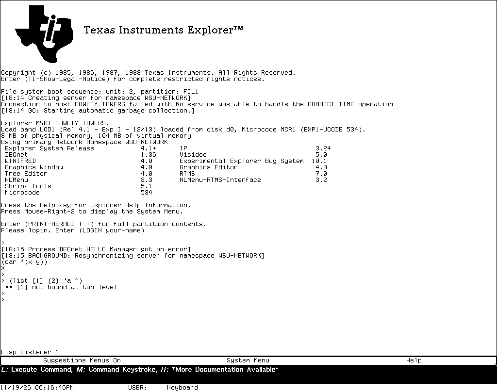

# TI Explorer I Lisp Machine (Meroko emulator)

A complete, ready-to-run Texas Instruments **Explorer I** Lisp machine:
the *Meroko* hardware-level emulator, the Explorer's PROM images, and disk
images holding Explorer System Release 4.1.  Build it, run it, and a
couple of minutes later you are typing at a 1988 Lisp Listener.

Meroko emulates the Explorer I at the microcode level: the "Raven" CPU, the
NuBus, the 8 MB memory board, the NuPI disk controller and the SIB (System
Interface Board: screen, keyboard, mouse, clocks).  The real PROMs and the
real microcode run unmodified.

This repository is a packaging of the last public Meroko release
(2006-06-10, from <https://www.unlambda.com/meroko/>) brought up to date so
that it builds and runs on a current 64-bit Linux system.  See
[Changes from the 2006 release](#changes-from-the-2006-release).

## Quick start

Install the build requirements:

    # Fedora
    sudo dnf install gcc make pkgconf-pkg-config SDL3-devel ncurses-devel xz

    # Debian / Ubuntu
    sudo apt install build-essential pkg-config libsdl3-dev libncurses-dev xz-utils

Then:

    make
    ./meroko -n

`make` compiles the emulator and unpacks the three disk images (about
340 MB) into `disks/`.  Run `meroko` from the top directory of the
repository; it looks for `proms/` and `disks/` there.

A window titled *Meroko* opens.  What you will see:

1. The power-on self tests (`Slot 6 TESTING SYSTEM` ...), about 20 seconds.
2. A prompt for the load source.  Press **D** for the default load, or
   just wait and it is taken for you.
3. The microcode and the Lisp world load, the screen clears, and the
   Explorer herald and a `>` prompt appear in a Lisp Listener.  This takes
   about a minute and a half in all.

Now type some Lisp:

    > (car '(x y))
    X
    > (login 'me)

To quit, close the window or press Ctrl-C in the terminal you started it
from.  The Explorer is not shut down first, which it tolerates fine, but
see [Disks](#disks).

## Running

    ./meroko [-n] [-l] [-t] [-f]

| Option | Meaning |
|--------|---------|
| `-n` | No curses status display; emulator messages go to standard output. This is the easy way to run it. |
| `-l` | Write a debug log to `DEBUG.LOG` (large). |
| `-t` | Trace microinstructions (needs a build with `-DTRACELOG`). |
| `-f` | Full speed.  Normally the CPU is held to the speed of the real machine so that clocks and key repeat behave; this lets it run as fast as the host can go, which makes the Explorer's clock run fast too. |
| `-h` | Show the options. |

Without `-n`, the terminal shows a curses front panel with the CPU state
(micro-PC, buses, registers) and a message window.  It wants a large
terminal, 50 lines or more.  Keys typed in that terminal:

| Key | Action |
|-----|--------|
| `h` | Halt the CPU |
| `g` | Go (continue) |
| `s` | Single-step one microinstruction |
| `d` | Dump: `SCREENSHOT.BMP` plus `WCS.DUMP`, `AMEM.DUMP`, `MMEM.DUMP`, `PMEM.DUMP`, `CPU.DUMP` |
| `r` | Force a trap |
| `l` | Start logging to `DEBUG.LOG` |
| `t` | Start tracing |
| Ctrl-C | Exit |

Sending the process `SIGUSR1` (`pkill -USR1 meroko`) makes the same dump
as `d`, and works with `-n` too.

### Keyboard

The Explorer keyboard has many keys a PC lacks.  A US PC keyboard is
mapped like this:

| PC key | Explorer key |
|--------|--------------|
| letters, digits, punctuation | the same |
| Backspace, Delete | RUBOUT |
| Enter | RETURN |
| Esc | ESCAPE |
| Tab | TAB |
| Ctrl | CONTROL |
| Alt | META |
| Windows key | SUPER |
| Caps Lock | CAPS LOCK |
| arrow keys | arrow keys |
| F1 | SYSTEM |
| F2 | NETWORK |
| F3 | STATUS |
| F4 | TERM |
| F5 | HELP |
| F6 | CLEAR INPUT |
| Page Up | ABORT |
| Page Down | RESUME |
| Home, Insert | function keys F1, F2 |

`( ) [ ] { } ~` and the backquote are where a PC user expects them; the
emulator presses the Explorer's shift key for you where the two layouts
differ.  Keys that are not mapped are ignored (with `Keystroke lost` in
the message log).  Your window manager may keep some combinations, the
Windows key especially, for itself.

Useful to know: **ABORT** (Page Up) gets you out of most things, **HELP**
(F5) gives help nearly everywhere, and **SYSTEM** (F1) followed by a
letter selects a program: `SYSTEM L` the Lisp Listener, `SYSTEM E` the Zmacs
editor, `SYSTEM HELP` the list.

### Mouse

The Explorer draws its own mouse cursor, so the host pointer is hidden
while it is over the window, and the Explorer's cursor follows it.  All
three buttons are passed through.  Clicking the right button twice
quickly brings up the System Menu.

The window can be resized; the picture is scaled and keeps its shape.

### Time

The Explorer takes the date and time from the host when it boots.

## Disks

Three disk images, dumped from a real Explorer I named `FAWLTY-TOWERS`,
are attached, each 112,446,208 bytes:

| File | Unit | Contents |
|------|------|----------|
| `disks/c0-d0.dsk` | 0 | Boot disk: microcode (`MCR1`, EXP1-UCODE 534), Lisp world (`LOD1`, Rel 4.1), GDOS diagnostics |
| `disks/c0-d1.dsk` | 1 | Lisp machine file system (`FIL1`) |
| `disks/c2-d0.dsk` | 4 | Paging space (`PAGE`), diagnostics |

The repository stores them compressed (`disks/*.dsk.xz`, 30 MB in all).
`make` unpacks them once.  The emulator then **writes to the unpacked
`.dsk` files**, so what you save in the Explorer's file system persists
from run to run.  The `.xz` files stay pristine:

    make reset-disks      # discard your working disks, unpack fresh ones

`tools/epart` (built by `make`) prints the partition table of a disk
image, and can extract a partition or change which one is active:

    tools/epart disks/c0-d0.dsk
    tools/epart -e LOD1 disks/c0-d0.dsk     # copy partition LOD1 out to ./ext.lod

## What works and what does not

Works: PROM self tests, booting microcode and Lisp from disk, screen,
keyboard, mouse, disks, clocks and the Lisp Listener; in short the
Explorer as a standalone machine.  According to the original notes,
pressing **G** at the load prompt instead of D loads the GDOS diagnostics.

Does not work:

- **Networking.**  The Ethernet board emulation was never finished and is
  left out of the default build; the Explorer boots as a machine with no
  network, and you will see a couple of harmless complaints about that
  (`Connection to host FAWLTY-TOWERS failed`, `DECnet HELLO Manager got an
  error`).  `make clean; make ENET=1` includes the board as it stood in
  2006; Lisp then finds it, times out talking to it (`Ethernet controller
  command timed out`), and stops in the error handler during boot.  `contrib/network/` holds the
  unfinished Linux TAP interface work from the same era.
- **Sound**, the serial and parallel ports, and tape.
- The original Linux framebuffer-console display (`-DDISPLAY_FB`) is still
  in `src/sib.c` but has not been built or tested here.

## Layout

    Makefile
    src/            the emulator
      meroko.c        main program, curses front panel, logging
      raven_cpu.c     the Explorer I ("Raven") processor, microcode disassembler
      mem8.c          8 MB memory board
      nupi.c          NuPI disk controller
      sib.c           System Interface Board: video, keyboard, mouse, RTC, timers
      enet.c          Ethernet board (unfinished; ENET=1)
      nubus.c, localbus.c   bus signals
      sdl.c, keysym.h SDL3 window, keyboard and mouse
    proms/          PROM images from the real hardware (CPU, SIB, NuPI, memory, Ethernet)
    disks/          disk images, xz-compressed
    tools/epart.c   disk partition table tool
    contrib/network/  unfinished TAP networking code and setup scripts
    doc/original/   the 2006 release's own READ-THIS, notes, key map, makefiles

## Changes from the 2006 release

The 2006 source assumed a 32-bit x86 Linux with SDL 1.2.  Changed here:

- **64-bit clean.**  `unsigned long` was used as a 32-bit type throughout;
  it is now `unsigned int`.
- **SDL3** instead of SDL 1.2 (`src/sdl.c` rewritten).  The window is
  resizable, and the Explorer's mouse position follows the host pointer.
- **Real-time speed regulation.**  The old code ran a busy loop tuned once
  a second, which on a modern host let the machine run many times too
  fast: the clock raced and held keys repeated wildly.  The CPU is now
  paced against the host clock (`-f` turns that off).  It no longer burns a
  whole host core when the Explorer is idle either.
- **Keyboard fixes.**  Typing `[`, `]` or `~` left the Explorer's shift
  key stuck or released; key translation now remembers what it pressed.
- Two out-of-bounds memory accesses fixed (one in the display code that
  crashed under current SDL, one in the front panel).
- The real-time clock is advanced in `-n` mode too.
- Disk images live in `disks/` rather than `X1-DISKS/`; the screen is
  built at the Explorer's native 1024 x 808; one portable Makefile.
- New: `-f`, `-h`, the `SIGUSR1` dump, `make reset-disks`.
- `tools/epart.c` fixed to build on 64-bit.

The emulation itself (CPU, buses, devices) is otherwise untouched.

## Credits

- **Daniel Seagraves** wrote Meroko.
- **Brad Parker** wrote the SDL display and keyboard code, rewrote the
  DISPATCH instruction and the MMU, wrote `epart`, and published the
  releases and disk images at unlambda.com.
- **Alastair Bridgewater**'s *Nevermore* emulator was used as a reference.
- **Jeffrey Katcher** contributed FreeBSD support.
- **Bjorn** (as the Meroko page names him) worked with Daniel on the
  networking code in `contrib/network/`.

## License

Meroko is distributed under the GNU General Public License, version 2;
see [COPYING](COPYING).

The PROM images in `proms/` and the software on the disk images are
copyright Texas Instruments Incorporated (1985-1988).  They are not
covered by the GPL.  They are included here, as they have been with the
Meroko releases since 2005, for historical preservation and to make the
emulator usable.

## Further reading

- Explorer documentation at Bitsavers:
  <http://www.bitsavers.org/pdf/ti/explorer/>
- The Meroko page: <https://www.unlambda.com/meroko/>
- `doc/original/READ-THIS`, the original release notes
